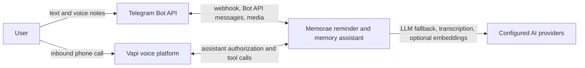
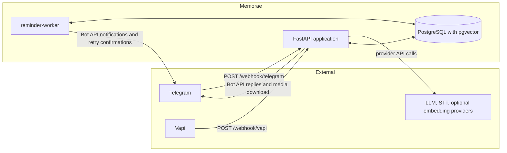
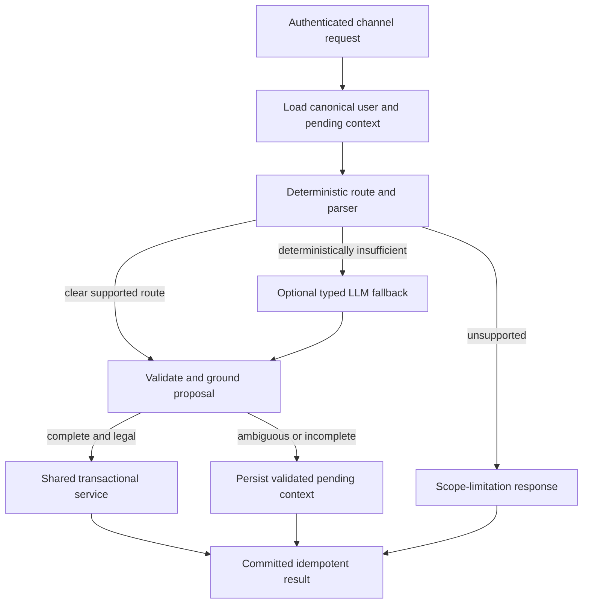
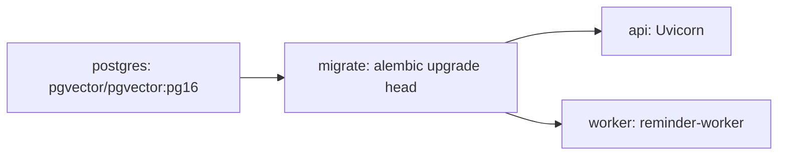

# Memorae — As-Built Architecture

> **Status:** This document describes the repository as implemented at Alembic
> revision `0017_voice_call_authorizations`. Source code, migrations, Compose
> configuration, and tests are the evidence for this document. It supersedes
> the former planning-oriented architecture narrative as the description of the
> running system.

## 1. Architecture overview

Memorae is a Python 3.12/FastAPI reminder and memory assistant. It receives
Telegram text, Telegram voice notes, and authenticated Vapi voice-call tool
requests. Reminders are always delivered through Telegram. PostgreSQL is the
source of truth for users, channel identities, reminders, memory facts,
conversation state, idempotency results, and delivery state. A separate worker
polls PostgreSQL to materialize recurring work and send Telegram messages.

The implemented architecture has these important constraints:

- Channel adapters authenticate provider input, establish a canonical user,
  then delegate to shared workflows. They do not own reminder or memory rules.
- Natural-language handling is deterministic first. A configured model may
  classify an uncertain request or propose typed route-specific parameters, but
  it does not authorize or execute a mutation.
- Every proposal is validated for schema, time zone, ownership, target
  grounding, legal state transition, and business rules before a shared service
  changes state. Unsupported, ambiguous, and incomplete requests are
  non-mutating responses or persisted clarifications.
- Committed idempotent results are the only source of durable-operation
  confirmations. Provider delivery runs after the database transaction.
- No queue, cache, broker, or public REST domain API is implemented.

## 2. System context (C4 level 1)



Telegram is both an inbound channel and the only implemented reminder-delivery
channel. Vapi supplies real-time speech interaction; it calls Memorae to
authorize a caller, obtain a transient assistant configuration, and invoke
server tools with the caller's raw utterance. AI services are external
dependencies, not authorities over user data or operations.

## 3. Containers (C4 level 2)



The FastAPI process composes routers, SQLAlchemy sessions, configuration, and
optional LLM/STT/embedding adapters. Its implemented endpoints are:

| Endpoint | Implemented responsibility |
| --- | --- |
| `POST /webhook/telegram` | Authenticates and processes Telegram updates. |
| `POST /webhook/vapi` | When enabled, authenticates Vapi assistant requests, tool calls, and end-of-call reports. |
| `GET /health` | Process liveness. |
| `GET /ready` | Database reachability plus required tables, columns, and exact migration-head check. |

There are no `/api/v1` user, reminder, or memory endpoints. `reminder-worker`
is an independent long-running process; it delivers scheduled notifications and
retries eligible Telegram confirmations. Both processes use the same database.

## 4. Components and boundaries

| Area | Responsibility |
| --- | --- |
| `channels/telegram` | Validates Telegram payloads, verifies the webhook secret, adapts callbacks and media, and calls the Bot API. |
| `channels/vapi` | Verifies the Vapi Bearer token, validates server messages, produces transient assistant/tool configuration, and formats tool results. |
| `application` | Channel-neutral request contracts, identity contexts, conversation coordination, reminder-update workflows, response delivery, and Vapi call workflows. |
| `features/intent` | Deterministic routing/parsing plus optional typed model fallback and request policy. |
| `features/onboarding` | Telegram onboarding, IANA time-zone validation, contact ownership checks, and phone linking. |
| `features/reminders` | Creation, listing/summary, recurrence, rescheduling, cancellation, completion, snooze, ownership checks, and presentation. |
| `features/memory` | Owner-scoped fact save/retrieval, lexical and optional semantic retrieval, embedding lifecycle, and backfill. |
| `infrastructure` | SQLAlchemy models/sessions, runtime worker, provider implementations, settings, and structured logging. |
| `shared` | Cross-feature idempotency and channel-neutral DTO/helpers. |

The composition root in
[`application/main.py`](../src/reminder_agent/application/main.py) intentionally
imports adapters and providers to build the application. Architecture tests
enforce that feature/application code does not depend on Telegram payload types.

## 5. Key runtime flows

### Telegram message and voice-note processing

1. Telegram calls `POST /webhook/telegram`; the adapter compares
   `X-Telegram-Bot-Api-Secret-Token` in constant time and validates the update.
2. Onboarding updates are processed before normal commands. Otherwise the
   adapter resolves a linked Telegram identity and creates a trusted application
   request; user-supplied IDs are not authority.
3. A voice note is accepted only on this authenticated path. The adapter bounds
   duration and bytes, downloads a private OGG/Opus file into memory, validates
   its format, and transcribes it through the configured transcriber. Audio
   is not persisted. A transcription failure returns text and performs no
   mutation.
4. The text or transient transcript enters the same conversation workflow.
   Telegram update ID and raw-payload digest remain the idempotency identity for
   a voice-note replay.
5. A durable result is committed with its idempotency response. The webhook
   immediately attempts the Telegram reply after commit; failure is recorded for
   the confirmation worker. Completion callbacks are acknowledged and signed
   callback data is resolved against an owned delivered occurrence.

### Intent routing, clarification, and execution



Deterministic routing is authoritative when it recognizes a request. The
optional `IntentRouter` classifies only when routing is insufficient; the
optional `ReminderIntentInterpreter` then obtains structured parameters only
for the selected route. Typed schemas, source grounding, user time zone,
owner-scoped candidate lookup, and state checks reject invalid proposals. An
unresolved or unsupported intent never reaches extraction or mutation.

`conversation_sessions` keeps validated pending creation, reschedule,
cancellation, completion, snooze, and memory contexts. A reply is first
resolved in its original operation context; an explicit new request may
supersede it, and a safe cancellation ends it without mutation. Sessions are
versioned, locked for updates where needed, and expire after the configured
TTL (900 seconds by default).

### Vapi call processing

```mermaid
sequenceDiagram
    participant Caller as Caller
    participant Vapi as Vapi voice runtime
    participant API as Memorae API
    participant DB as PostgreSQL
    participant TG as Telegram

    Caller->>Vapi: Inbound audio call
    Vapi->>API: assistant-request with caller number
    API->>DB: Resolve linked phone identity; create or replay call authorization
    API-->>Vapi: Transient assistant, model, voice, and server-tool configuration
    Note over Vapi: Vapi owns live speech recognition, speech synthesis,<br/>conversation turn-taking, and tool selection.
    Vapi->>API: tool-calls with raw utterance
    API->>DB: Revalidate call, route, validate, commit idempotent result
    API-->>Vapi: Tool result text
    Vapi-->>Caller: Spoken result
    Note over API,TG: Scheduled reminders are delivered later by reminder-worker.
```

Memorae supplies Vapi's configured model and voice identifiers plus server-tool
instructions, but the Vapi platform performs real-time speech recognition,
speech synthesis, interruption handling, and speech turn-taking. Memorae only
receives authenticated server messages and raw tool utterances; it never trusts
the Vapi model to choose a user, reminder, schedule, or delivery destination.

1. Vapi requests require `VAPI_ENABLED=true` and a matching `Authorization:
   Bearer` credential. Disabled Vapi returns `404`; malformed or unauthenticated
   requests are rejected.
2. For an `assistant-request`, Memorae normalizes the Vapi caller number and
   finds an active user with a linked `PHONE` identity and configured time zone.
   It creates or replays a short-lived `VoiceCallAuthorization` binding keyed by
   provider call ID. Unknown, expired, conflicting, or unlinked callers get the
   same generic rejection response.
3. An authorized call receives three server tools:
   `submit_reminder_utterance`, `submit_memory_save_utterance`, and
   `submit_memory_lookup_utterance`. Each accepts exactly one bounded raw
   `utterance`; the backend, rather than Vapi, determines all IDs and fields.
4. Each tool reloads active call authorization and creates a Vapi idempotency
   key from call ID and tool-call ID. It uses the same deterministic routing,
   validation, ownership, and conversation mechanisms as Telegram. Reminder
   operations locate a linked Telegram identity server-side, so reminders
   created or changed on a call notify the user's Telegram chat.
5. An `end-of-call-report` ends the authorization binding. Vapi receives
   committed tool text synchronously; no Vapi outbound delivery worker exists.

### Reminder creation, scheduling, and delivery

Creation stores a reminder, its first occurrence, its Telegram notification,
and its idempotent response in one transaction. A reminder is one-time or
recurring; notifications are rows rather than in-memory timers.

The worker materializes upcoming recurring occurrences (35 days and 100 rows
per batch by default), recovers expired delivery claims, claims due
notifications, and delivers them. Claiming uses `FOR UPDATE SKIP LOCKED` and a
lease. The worker rechecks that reminder, occurrence, and Telegram destination
are active and owned by the same user before sending. Successful delivery marks
the notification `SENT` and the occurrence `NOTIFIED`; the message includes a
signed **Done** callback.

Completion changes an owned delivered occurrence. Snooze changes the existing
occurrence's `next_due_at` and delivery state rather than creating another
occurrence. Cancellation can cancel a one-time occurrence or a recurring
series; a future recurring occurrence not yet materialized is represented by a
local-calendar recurrence exception. Rescheduling locks targets and affected
pending notifications; a recurring request without a clear scope prompts for
occurrence versus series/future scope.

### Memory across channels

`memory_facts` stores authoritative, user-owned text. Save and retrieval are
available through Telegram and authenticated Vapi tools, so linked channels
share facts through canonical `user_id`. Retrieval first performs bounded
owner-scoped lexical search. An exact deterministic match can answer without an
LLM or embedding provider. Otherwise, when enabled and compatible, the service
performs owner- and active-model-scoped PostgreSQL cosine search and may pass
selected non-sensitive candidates to a grounded answer adapter. Returned answers
are checked against retrieved content; provider failure falls back to lexical
behavior or an unknown/clarification response.

Embedding is optional. New facts are `PENDING` when indexing is disabled;
provider failures are retained as `FAILED` without rolling back the fact.
`memory-embedding-backfill` processes bounded, resumable batches.
Model name and content hash prevent unnecessary regeneration. Sensitive facts
can be `SKIPPED_SENSITIVE` and remain lexically retrievable without external
embedding according to privacy policy; raw facts, transcripts, vectors, and
provider credentials are not intended for logs.

## 6. Persistence and time model

| Entity | Implemented purpose |
| --- | --- |
| `users` | Name, onboarding state, IANA time zone, and optional phone region. |
| `channel_identities` | Linked `TELEGRAM` or `PHONE` identities; stores Telegram chat ID. Partial unique indexes prevent external-ID reuse and limit each user to one linked phone identity. |
| `voice_call_authorizations` | Call-ID-to-user/phone-identity binding with `ACTIVE`, `ENDED`, or `EXPIRED` state. No caller number is copied. |
| `reminders` | User-owned task, one-time/recurring definition, local start, IANA time zone, recurrence rule, state, and version. |
| `reminder_occurrences` | Concrete due instances and mutable `next_due_at`; recurring instances have a stable local-wall-clock key. |
| `reminder_recurrence_exceptions` | Durable skipped local dates for one recurring series. |
| `notifications` | Telegram delivery intent, attempts, provider message ID, status, and claim lease. |
| `conversation_sessions` | Channel/session-scoped durable clarification state and active reminder context. |
| `idempotency_records` | Unique source/key request hash, committed response, operation result, and confirmation-delivery ledger. |
| `memory_facts` | Authoritative text plus nullable `vector(1536)` data and embedding lifecycle metadata. |

Schedules are interpreted using the active user's IANA time zone and persisted
as local schedule information plus UTC-aware occurrence times. Recurrence
materialization regenerates from the local schedule, so recurrence keys retain
the intended local wall-clock instant across DST. Unique occurrence keys and
conflict-safe insertion make repeated or concurrent materialization converge.

Durable business changes and their idempotent response are committed together.
Telegram provider calls occur after commit. Operations that alter a target use
owner-scoped selection and locking; a notification already being sent is not
silently invalidated.

## 7. Reliability and failure handling

- The worker polls every five seconds by default and waits a configurable
  15-second grace period before claiming a due reminder. This is not an
  implemented 60-second delivery SLA.
- Notification claims are database leases. A process that dies after a provider
  call but before finalization leaves an expired `SENDING` claim; it is recovered
  as `UNKNOWN` rather than replayed automatically because delivery may occur.
- Safe connection failures, rate limits, and bounded uncertain failures retry
  with backoff. Permanent failures are `FAILED`; ambiguous outcomes can be
  `UNKNOWN`. Delivery is not end-to-end exactly-once; retries can duplicate after
  an ambiguous network/provider outcome.
- Telegram confirmations use a separate idempotency-delivery ledger. The
  webhook attempts them immediately and `ConfirmationWorker` leases eligible
  `UNKNOWN` responses for bounded background retries.
- Replayed Telegram updates and Vapi tool calls return a recorded committed
  result when request hash matches. Reuse of a key for another request conflicts.
- Worker-loop exceptions are logged and processing continues. Persistence,
  notification state, and sessions survive restarts because work is rebuilt from
  PostgreSQL rows rather than process memory.

## 8. Security and identity

Telegram uses a configured secret header; Vapi uses a configured Bearer token.
Both comparisons use `hmac.compare_digest`. Production startup validates a
PostgreSQL URL, Telegram credentials, LLM/STT credentials, and enabled-provider
settings; Vapi additionally requires its credential and assistant/voice settings.

Telegram onboarding verifies that a shared contact belongs to the sender before
normalizing and linking its phone number. Phone linkage is optional for
Telegram-only use but required for Vapi access. Vapi authorization resolves the
normalized caller number to this linked identity, creates a call-scoped binding,
and every tool reloads that binding. A phone number outside this path is not
authority to access facts or reminders.

All reminder, occurrence, notification, and memory lookups are scoped to the
canonical user and revalidated before mutation. Vapi arguments deliberately
exclude user IDs, reminder IDs, fact IDs, schedules, and delivery destinations.
Provider credentials and personal payloads are excluded from normal structured
logs by the documented adapters.

## 9. Deployment and operations

[`docker-compose.yml`](../docker-compose.yml) defines local services:



`postgres` is exposed locally on port 5433. Optional `postgres-test` uses port
5434 and is separate from `DATABASE_URL`. `migrate` waits for PostgreSQL health
and must complete before API and worker start. API exposes port 8000 and checks
`/ready`; API and worker use `restart: unless-stopped` while migrations do not.

The Docker image uses the locked `uv` environment without development
dependencies. Production is an operational topology rather than a committed
hosting manifest: supply PostgreSQL and provider secrets, run migrations, run
API and worker separately, and make Telegram/Vapi webhooks reachable. The
repository has no Railway, Neon, CI/CD, or queue deployment definition; those
older references are intentions, not implemented infrastructure.

## 10. Trade-offs and limitations

- PostgreSQL polling is simple and restart-safe, but delivery latency depends on
  poll/grace settings and database availability.
- Notifications have a **Done** action but no automatic escalation for an
  unanswered reminder.
- Telegram is the only notification delivery adapter. Vapi returns tool text
  during a call but does not receive scheduled reminder calls.
- Vapi controls speech, interruption, and tool selection. Server tools protect
  mutations, but Memorae cannot guarantee conversation or audio quality.
- Semantic retrieval is optional and uses exact owner-filtered PostgreSQL vector
  search; no approximate vector index is configured.
- The deterministic parser supports only its implemented recurrence forms; it
  is not evidence of a general calendar engine.
- `/ready` is coupled to the known migration revision, so a new migration must
  update its readiness constant as release work.

## 11. Alignment with the former design

The former document mixed broad requirements, potential providers, and an early
implementation supplement. These deviations are explicit:

| Classification | Former description | As-built status |
| --- | --- | --- |
| Accurate | FastAPI, PostgreSQL/Alembic, Telegram delivery, a separate worker, deterministic validation, and owner-scoped data. | Retained here. |
| Outdated | Only early vertical slices were authoritative; obsolete module paths and ADR 0039 were cited. | Replaced with current paths and Vapi behavior. |
| Outdated | A public REST `/api/v1` domain API and status contract were documented. | Not implemented. Only webhooks, health, and readiness exist. |
| Missing | Vapi authorization bindings/tools, Telegram voice notes, confirmation retry ledger, recurrence exceptions, and semantic-memory lifecycle. | Documented above. |
| Planned/unverified | Railway, NeonDB, WhatsApp, Google Meet, Celery, Retell, LiveKit, Twilio, and a strict 60-second/exactly-once promise. | No repository implementation evidence. |

## 12. Architecture decision records

- [ADR 0001: deterministic-first hybrid NLP](adr/0001-deterministic-first-hybrid-natural-language-processing.md)
- [ADR 0002: separate intent classification and parameter extraction](adr/0002-separate-intent-classification-and-parameter-extraction.md)
- [ADR 0003: deterministic verification of LLM-proposed commands](adr/0003-deterministic-verification-of-llm-proposed-commands.md)
- [ADR 0004: structured memory intent evidence](adr/0004-structured-memory-intent-evidence.md)
- [ADR 0005: owner-scoped pgvector semantic memory](adr/0005-owner-scoped-pgvector-semantic-memory.md)
- [ADR 0006: Vapi sensitive-memory disclosure](adr/0006-vapi-sensitive-memory-disclosure.md)
- [ADR 0007: route-specific structured extraction prompts](adr/0007-route-specific-structured-extraction-prompts.md)

No ADR is created by this documentation update.
