# Memorae Challenge — System Design

> Cleaned and formatted version of the original challenge planning document. Architecture choices, workflows, open questions, diagrams, and data definitions are preserved; obvious typographical errors and duplicate lines have been tidied.

> **Implementation status:** Sections 1–8 preserve the original design; Section 9 is authoritative for the implementation through VS-13.

## 1. Overview and Scope

### Communication Channels

The system will support two communication channels:
1. **Telegram:** Users send text messages and voice notes, and receive reminders.
2. **Voice calls:** Users call a real phone number through Vapi or another voice platform and converse with the AI agent live.

Potential future channels include **WhatsApp** and **Google Meet**.

A single AI assistant, backend, and database will serve all channels. The backend should support adding further integrations without duplicating core business logic.

### Voice Platform Evaluation

Providers considered: **Vapi**, **Retell**, **LiveKit**, and **Twilio**.

**LiveKit:** Offers a customizable voice system, configurable interruption support, and US phone-number support. It introduces a medium-to-hard setup, more debugging complexity, and additional infrastructure work. Because the challenge prioritizes reliability rather than voice-infrastructure customization, this option is not preferred.

**Retell vs. Vapi:** The original evaluation notes compare these options as follows (figures are estimates from the original notes, not freshly verified prices or benchmarks):

| Consideration | Retell | Vapi |
| --- | --- | --- |
| Setup | Easier | Slightly more involved, but still relatively easy |
| Conversational naturalness | Perceived as more natural | Perceived as somewhat less natural |
| Initial credits | $10 | $5 |
| Phone number | US number purchased separately (about $2) | Free single-use inbound number |
| Median latency (noted estimate) | 1.04 seconds | 1.56 seconds |
| Estimated cost for 100 minutes | $7–$31 | $8–$31 |

### Selected Technology Stack

| Layer | Selection |
| --- | --- |
| Channels | Telegram, voice calls; WhatsApp and Google Meet as future extensions |
| Backend | Python + FastAPI |
| Hosting | Railway |
| Voice agent | Vapi |
| Speech-to-text (STT) | Groq Whisper |
| Large language model (LLM) | Groq GPT OSS 120B |
| Development database | Dockerized PostgreSQL |
| Production database | NeonDB (PostgreSQL) |
| ORM | SQLAlchemy |
| Migrations | Alembic |
| Scheduler | PostgreSQL-backed worker (potential future migration to Celery) |

**Design goal:** Keep STT and LLM integrations model- and provider-agnostic.

### System Design Process

Requirements and scope → user workflows and edge cases → domain model and business rules → high-level architecture (C4 diagrams) → API contracts and database schemas → implementation plan → first end-to-end implementation → architecture refinement as needed.

## 2. Requirements

### Functional Requirements

#### Phase 1: Telegram Text Interaction

1. The system should register a Telegram user when the user sends `/start` command.
2. The system shall request the user's phone number during Telegram onboarding using Telegram's native contact-sharing functionality.
3. The system should obtain the user's name during onboarding, either by inference or by asking the user.
4. The system shall prevent the same phone number from being associated with multiple active user accounts.
5. The system shall verify that the shared Telegram contact belongs to the sender and associate the normalized phone number with the user's internal account.
6. The system shall establish the user's time zone during the onboarding.
7. The system shall create a one-time reminder from a natural language text request specifying a task and time.
8. The system shall create a recurring reminder from natural language text specifying task and recurrence schedule.
9. When the reminder execution time or task itself is ambiguous or missing, the system shall request clarification.
10. The system shall confirm a newly created reminder with its scheduled local time and delivery channel.
11. The system shall deliver a scheduled reminder through Telegram at its execution time.
12. The system shall retrieve reminders matching a user-specified date or date range.
13. The system shall reschedule an existing reminder to a user-specified time.
14. The system shall cancel a user-selected reminder or recurring reminder series.
15. The system shall mark a selected reminder as completed when requested.
16. The system shall answer read-only reminder progress queries, including pending counts, today's remaining tasks, completed counts, and overdue counts.
17. The system shall snooze a selected reminder by a user-specified duration.
18. The system shall store a user-provided fact as a memory item without creating a reminder.
19. The system shall retrieve a previously stored fact in response to a user's query.
20. The system shall respond to requests outside its supported capabilities with a predefined scope-limitation message, without executing operations or modifying user data.
21. The system shall validate every requested operation, its parameters, and the user's authorization before execution, regardless of instructions contained in user input.
22. The system shall request clarification when it cannot reliably determine a supported intent, without executing an operation.

#### Phase 2: Telegram Voice Notes

22. The system shall accept voice-note messages from Telegram users.
23. The system shall transcribe the spoken content of a received voice note into text.
24. The system shall support the Phase 1 (Telegram text interaction) reminder and memory operations when requested through a voice note.
25. The system shall send clarification questions and command confirmations as Telegram text messages in response to voice-note requests.

#### Phase 3: Real-Time Voice Calls

26. The system shall accept incoming calls through a real telephone number from Vapi.
27. The system shall identify incoming callers by matching the caller's phone number received from Vapi against registered phone numbers.
28. The system shall permit registered callers to access the voice agent and reject unidentified or unregistered callers before starting an AI conversation.
29. The system shall resolve an authorized caller's internal user ID to access their existing reminders, memories, and Telegram delivery destination.
30. The system shall interpret spoken requests received during an active call.
31. The system shall support the Phase 1 reminder and memory operations through spoken requests during a call.
32. The system shall generate spoken responses to user requests during an active call.
33. The system shall verbally confirm a created reminder's exact scheduled local time and delivery channel.
34. The system shall retain conversational context across successive user utterances within a call.
35. The system shall stop its current spoken response when the caller interrupts it.
36. The system shall apply a caller's correction to the previously referenced reminder rather than create a new reminder.
37. The system shall make a user's saved facts and reminders accessible across their associated Telegram and voice-call sessions.
38. Reminders created during voice calls should be delivered on Telegram.

### Quality Attributes

1. Every reminder shall be delivered no more than 60 seconds after its scheduled time.
2. Each scheduled reminder shall be delivered once, without duplicate notifications.
3. Reminders and user memories shall survive application restarts and deployments.
4. Scheduling and reminder display shall respect the user's configured time zone, including recurrence.
5. Voice interaction shall remain usable with interruptions, silence, and imperfect audio.
6. All channels shall access the same current reminder and memory state for an associated user.
7. A new user shall be able to begin using the agent within one minute, without forms or payment.
8. The delivered system shall be reproducibly launchable using a single command and documented configuration.

## 3. User Workflows

A user workflow specifies the actor, goal, trigger, preconditions, successful path, alternatives and failures, and postconditions. The workflows below are organized by implementation phase; unresolved questions are retained.

Each workflow documents the **actor**, **goal**, **trigger**, **preconditions**, **main flow**, **alternative flows**, **failure flows**, **postconditions**, and **open questions or assumptions**.

### Phase 1: Telegram Text Interaction

#### 1. Register and onboard a Telegram user

**Actor:** New User

**Goal:** Register with the agent and link a phone number for future voice-call access.

**Trigger:** User opens the Telegram bot and sends `/start`.

**Preconditions**

1. The Telegram bot is accessible.
2. The user has a Telegram account.

**Main flow**

1. User sends `/start` to the Telegram bot.
2. System identifies the Telegram user using their Telegram ID.
3. System obtains the user's name.
4. System obtains the user's time zone.
5. User shares their phone number.
6. System verifies that the shared contact belongs to the Telegram user.
7. System checks that the phone number is not associated with another active account.
8. System creates the user profile and associates their Telegram ID and phone number.
9. System confirms successful registration.

**Alternative flows**

1. System infers the user's name from their Telegram profile.
2. System requests manual time-zone selection when it cannot determine one.

**Failure flows**

1. User declines phone sharing → onboarding completes but user is notified that they cannot call the agent.
2. Shared contact does not belong to the sender → system rejects the contact.
3. Phone number is already registered → system rejects the association.
4. User provides an invalid time zone → system requests a valid one.
5. Profile storage fails → system reports that setup could not be completed.

**Postconditions**

1. A user profile exists with a Telegram identity, name, and time zone; the phone number is optional.
2. Telegram identity is associated with the internal user.
3. User can use the Telegram agent and is eligible for phone-number-based voice-call access.

**Open questions / assumptions**

1. Telegram ID uniquely identifies the user within the text channel.

#### 2. Create a reminder through Telegram text

**Actor:** Registered User

**Goal:** Schedule a one-time or recurring reminder using natural language.

**Trigger:** User sends a reminder request through Telegram.

**Preconditions**

1. User has completed onboarding
2. User has a configured time zone

**Main flow**

1. User sends a message such as "Remind me tomorrow at 9 to call the bank."
2. System identifies the reminder intent and extracts the task, date, time, and recurrence if specified.
3. System interprets the schedule using the user's time zone.
4. System creates and schedules the reminder.
5. System confirms the scheduled time and Telegram delivery channel.

**Alternative flows**

1. User requests a recurring reminder → system creates a recurring schedule.
2. User supplies an incomplete or ambiguous time → system requests clarification before scheduling.
3. User specifies a future relative time such as "in 5 minutes" → system resolves the execution time.

**Failure flows**

1. System cannot interpret the request → asks the user to rephrase.
2. Reminder persistence fails → informs the user that the reminder was not created.

**Postconditions**

1. A reminder is persisted with its task, schedule, user, and delivery channel.
2. Reminder is available for future delivery and management.

**Open questions / assumptions**

1. Assumption: Telegram is the default delivery channel for text-created reminders.
2. What should happen when a user specifies a date but no time?

#### 3. Receive and respond to a scheduled reminder

**Actor:** Registered User

**Goal:** Receive a reminder and acknowledge or postpone it.

**Trigger:** A reminder reaches its scheduled execution time.

**Preconditions**

1. An active reminder exists.
2. The user has access to the Telegram bot.

**Main flow**

1. The scheduled execution time arrives.
2. System sends the reminder notification through Telegram.
3. User responds with something like "Done."
4. System marks the reminder occurrence as completed.
5. System confirms completion.

**Alternative flows**

1. User responds "10 more minutes" → system reschedules the reminder occurrence for 10 minutes later.
2. User does not respond → the reminder remains unacknowledged.

**Failure flows**

1. Telegram delivery fails → system retries according to its delivery policy.
2. System cannot persist the completion or snooze action → informs the user that the action was unsuccessful.

**Postconditions**

1. Reminder delivery outcome is recorded.
2. Reminder occurrence is either completed, snoozed, or awaiting acknowledgment.

**Open questions / assumptions**

1. Should unacknowledged reminders generate additional notifications?
2. How should snoozing interact with recurring reminders?

#### 4. Retrieve scheduled reminders

**Actor:** registered user

**Goal:** see reminder scheduled for a particular period

**Trigger:** user asks something like "what do i have tomorrow"

**Preconditions**

1. User has completed onboarding.

**Main flow**

1. User requests reminders for a date or date range.
2. System interprets the requested period using the user's time zone.
3. System retrieves matching reminders.
4. System returns the reminders with their descriptions and scheduled times.

**Alternative flows**

1. No reminders match → system informs the user that the requested period has no reminders.
2. User specifies a different period → system retrieves reminders for that period.

**Failure flows**

1. Reminder retrieval fails → system reports that the list is temporarily unavailable.

**Postconditions**

1. User receives the requested reminder list.
2. Reminder records remain unchanged.

**Open questions / assumptions**

1. Assumption: The default response contains scheduled and active reminders, not completed ones.

#### 5. Change an existing reminder's schedule

**Actor:** registered user

**Goal:** Move an existing reminder to a different time.

**Trigger:** User sends something like "Move the bank reminder to 10."

**Preconditions**

1. User is registered.
2. The target reminder exists.

**Main flow**

1. User requests a schedule change.
2. System identifies the referenced reminder.
3. System determines the requested new date and time.
4. System updates the existing reminder's schedule.
5. System confirms the new scheduled time.

**Alternative flows**

1. Multiple reminders match → system asks which reminder to modify.
2. New time is ambiguous → system asks for clarification.
3. Target is recurring → system determines whether the change applies to one occurrence or the series.

**Failure flows**

1. Referenced reminder does not exist → system informs the user.
2. Schedule update fails → existing reminder remains unchanged and system reports the failure.

**Postconditions**

1. Existing reminder has the updated schedule.
2. Previous scheduling information is no longer active for the modified occurrence.

**Open questions / assumptions**

1. Should recurrence updates default to one occurrence or the entire series?

#### 6. Cancel a scheduled reminder

**Actor:** registered user

**Goal:** Prevent an existing reminder from being delivered.

**Trigger:** User sends something like "Cancel the gym reminder."

**Preconditions**

1. User is registered.
2. An active matching reminder exists.

**Main flow**

1. User requests cancellation of a reminder.
2. System identifies the referenced reminder.
3. System cancels the selected reminder or reminder series.
4. System confirms the cancellation.

**Alternative flows**

1. Multiple reminders match → system requests clarification.
2. User cancels a recurring series → system cancels its future occurrences.

**Failure flows**

1. Reminder does not exist → system informs the user.
2. Cancellation fails → system reports that the reminder remains active.

**Postconditions**

1. Canceled reminder occurrences are no longer eligible for delivery.

**Open questions / assumptions**

1. Should users be able to cancel a single occurrence of a recurring reminder?

#### 7. Save a user-provided fact

**Actor:** registered user

**Goal:** Store information that can be retrieved later.

**Trigger:** User sends something like "Remember my gate code is 4512."

**Preconditions**

1. User is registered.

**Main flow**

1. User provides information with an instruction to remember it.
2. System identifies the request as a memory operation.
3. System extracts the fact to be stored.
4. System associates the fact with the user and persists it.
5. System confirms that the information was saved.

**Alternative flows**

1. User provides an updated value for a previously saved fact → system updates the fact
2. In Phase 3, user provides the fact during a voice call → system stores it in the same user memory.

**Failure flows**

1. System cannot determine what should be remembered → asks for clarification.
2. Storage fails → system informs the user that the information was not saved.

**Postconditions**

1. Fact is stored in user memory.
2. No reminder is created.

**Open questions / assumptions**

1. How should conflicting or duplicate facts be handled?
2. What sensitive information, if any, should the system refuse to store?

#### 8. Retrieve a previously stored fact

**Actor:** registered user

**Goal:** Recall information previously shared with the agent.

**Trigger:** User asks something like "What's my gate code?"

**Preconditions**

1. User is registered.
2. A relevant fact has previously been stored.

**Main flow**

1. User asks a question about stored information.
2. System identifies the requested fact.
3. System retrieves the matching fact from the user's memory.
4. System responds with the stored information.

**Alternative flows**

1. Multiple facts match → system asks which fact the user wants.
2. The fact was saved during a voice call → system retrieves it through Telegram using the same user memory.

**Failure flows**

1. No matching fact exists → system informs the user that it does not know the answer.
2. Memory retrieval fails → system reports that it cannot retrieve the information.

**Postconditions**

1. Requested information is returned to the user.
2. Stored memory remains unchanged.

**Open questions / assumptions**

1. How should the system handle retrieval of outdated facts?

### Phase 2: Telegram Voice Notes

#### 9. Perform a supported operation using a Telegram voice note

**Actor:** registered user

**Goal:** Access reminder and memory functionality through spoken instructions.

**Trigger:** User sends a Telegram voice note.

**Preconditions**

1. User has completed onboarding.
2. Telegram voice-note processing is available.

**Main flow**

1. User records and sends a voice note.
2. System transcribes the speech into text.
3. System identifies the requested operation.
4. System routes the request to the appropriate reminder or memory workflow.
5. System executes the operation.
6. System returns the result as a Telegram text response.

**Alternative flows**

1. Voice note omits the execution time → system proposes a time and requests confirmation.
2. Voice note requests another supported operation, such as canceling a reminder or saving a fact → system executes the corresponding existing workflow.

**Failure flows**

1. Audio cannot be transcribed → system asks the user to resend the voice note or use text.
2. Request is unsupported → system returns the predefined out-of-scope response.
3. Transcribed instruction is unclear → system requests clarification.
4. Reminder creation fails → system reports that no reminder was scheduled.
5. Memory creation fails → system reports that no memory was saved.

**Postconditions**

1. Any created or updated reminders and memories are available across the user's linked channels.
2. User receives a text confirmation.

**Open questions / assumptions**

1. Assumption: Voice notes receive text responses; spoken replies are not required.
2. Assumption: Telegram voice-note responses are always text.

### Phase 3: Real-Time Voice Calls

#### 10. Create a Reminder/Memory During a Voice Call

**Actor:** Registered user / caller

**Goal:** Schedule a reminder or save a memory verbally during a real-time call and receive the notification on Telegram.

**Trigger:** User calls the agent's phone number

**Preconditions**

1. Voice-call service is available.
2. Caller has completed Telegram onboarding.
3. Caller has a phone number associated with their account.
4. Vapi provides the caller's phone number.
5. The caller can be associated with the correct Telegram user.

**Main flow**

1. User calls the Vapi phone number.
2. Vapi sends the incoming call information to the backend.
3. Backend extracts and normalizes the caller's phone number.
4. Backend searches for the phone number in registered channel identities.
5. If a registered identity exists, the backend resolves its internal user ID.
6. System allows the voice agent to start the conversation.
7. User says something like "Remind me  in 5 minutes to send the contract." or maybe "My gate lock code is 1234"
8. System interprets the spoken request and identifies the task, scheduled time or save a memory fact, and Telegram delivery channel.
9. System creates the reminder associated with the user's Telegram account.
10. System verbally confirms the exact scheduled local time and Telegram delivery channel or that the fact has been saved.
11. At the scheduled time, system delivers the reminder to the user's Telegram account.

**Alternative flows**

1. User requests a recurring reminder → system creates a recurring schedule.
2. Date or time is ambiguous → system asks for clarification during the call.
3. User provides multiple reminder or memory requests → system processes them individually within the same conversation.
4. Caller is not yet linked to a Telegram identity → system requests account linking before Telegram delivery.

**Failure flows**

1. Call disconnects before reminder creation completes → system does not claim that the reminder was created.
2. Speech cannot be understood → system requests repetition.
3. Reminder creation or memory saving fails → system informs the caller that the reminder was not scheduled.
4. Phone number is not registered → reject the call before starting the AI agent.
5. Caller ID is missing → reject the call.
6. Identity lookup fails → reject the call rather than allowing unauthenticated access.

**Postconditions**

1. Reminder and the fact is persisted and associated with the correct Telegram user.
2. User receives verbal confirmation.
3. At execution time, the reminder is delivered through Telegram and its delivery outcome is recorded.

**Open questions / assumptions**

1. Critical: How will the system securely associate a caller's phone identity with their Telegram account?
2. Should an unlinked caller be able to create a reminder before completing Telegram onboarding?

#### 11. Interrupt and Correct a Reminder During a Call

**Actor:** Registered user / caller

**Goal:** Correct a reminder's details during an ongoing voice conversation without creating a duplicate.

**Trigger:** User interrupts the agent with a correction such as "Actually, make it half an hour."

**Preconditions**

1. An active voice conversation exists.
2. A reminder has been created or is currently being discussed.
3. The agent has sufficient conversational context to identify that reminder.

**Main flow**

1. System is speaking about the current reminder.
2. User interrupts with a correction to the scheduled time.
3. System stops its current spoken response and interprets the correction.
4. System identifies the reminder referenced by the conversation.
5. System updates that reminder's schedule without creating another reminder.
6. System verbally confirms the corrected local time and delivery channel.

**Alternative flows**

1. User corrects the task description rather than the time → system updates the description.
2. User's correction is ambiguous → system requests clarification.
3. User refers to another reminder → system identifies which reminder should be modified.

**Failure flows**

1. System cannot identify the referenced reminder → asks the caller to specify it.
2. System cannot understand the interruption → asks the caller to repeat.
3. Reminder update fails → system reports the failure without claiming that the change succeeded.

**Postconditions**

1. The existing reminder reflects the user's correction.
2. The prior schedule is replaced for the selected occurrence.
3. No duplicate reminder is created.

**Open questions / assumptions**

1. How should an interruption be handled when a reminder is being created but has not yet been saved?
2. How long should conversational context be retained after the call ends?

#### 12. Handle out-of-scope and unrecognized user requests

**Actor:** Registered user

**Goal:** Receive a clear, limited response when a request is outside the agent's supported capabilities, without triggering unintended operations.

**Trigger:** User sends a text message, voice note, or spoken request during a call.

**Preconditions**

1. User is interacting through a supported channel.
2. The system has a predefined set of allowed operations.

**Main flow**

1. User submits a request.
2. System evaluates the request against its supported intents.
3. System determines that the request is outside its supported capabilities.
4. System returns a predefined response: "I can only help you create and manage reminders and remember information."
5. System remains available for the next request.

**Alternative flows**

1. Greeting: System returns a brief predefined greeting and explains its capabilities.
2. Ambiguous request: System asks a clarification question before performing any operation.
3. Contextual follow-up: System identifies that the request relates to an active reminder or memory interaction and continues the appropriate workflow.
4. Voice note: System delivers the fallback response through Telegram text.
5. Voice call: System delivers the fallback response verbally and continues listening

**Failure flows**

1. Unrelated requests: System does not follow instructions attempting to override its permitted behavior and returns the predefined fallback response.
2. System cannot understand the interruption → asks the caller to repeat.
3. Repeated unsupported requests: System continues to enforce its supported scope without entering unrestricted conversation.

**Postconditions**

1. No unauthorized or unsupported operation is executed.
2. No reminder or memory is created, modified, or deleted.
3. The system remains restricted to its predefined capabilities.

**Open questions / assumptions**

1. Assumption: The agent is strictly task-oriented and does not support general-purpose conversations.
2. Assumption: Supported operations are validated by the backend, independently of the LLM.
3. Should the system limit repeated unsupported requests during a voice call to control costs?

## 4. Domain Model and Business Rules

A domain model captures the business concepts, their relationships, the rules they follow, and how their state changes. It is derived from the functional requirements and user workflows.

### Domain Model Components

1. **Entities:** Concepts with their own identities and lifecycles.
2. **Value objects:** Values identified by their contents rather than by a unique identity.
3. **Relationships:** Associations between domain concepts.
4. **Business rules:** Conditions that must remain true.
5. **Behaviors and state:** Allowed operations and state changes.

### Core Domain Entities

- **User:** User ID, Name, Time zone, Phone number (optional), Onboarding status.
- **Channel Identity:** Identity ID, User ID, Channel type, External identifier, Verification status.
- **Reminder:** Reminder ID, Owner ID, Task, Scheduled time, Status.
- **Reminder Occurrence:** Occurrence ID, Reminder ID, Scheduled time, Status.
- **Notification:** Notification ID, Occurrence ID, Destination, Due time, Delivery status.
- **Memory Fact:** Fact ID, Owner ID, Content, Creation/update timestamps.
- **Conversation Session:** Session ID, User ID, Channel, Active reference, Pending clarification.

### Entity Relationships

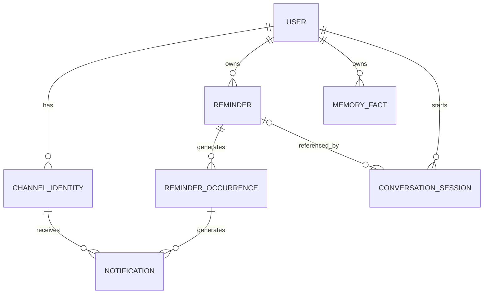

### State Transitions and Operations

- **User:** onboarding -> active
- **Channel Identity:** pending -> linked -> unlinked
- **Reminder states:** `ACTIVE`, `COMPLETED`, `CANCELED`
- **Reminder Occurrence states:** `PENDING`, `NOTIFIED`, `COMPLETED`, `CANCELED`
- **Operations:** `create`, `reschedule`, `snooze`, `complete`, `cancel`
- **Notification:** PENDING → SENDING → SENT / FAILED / UNKNOWN
- **Memory Fact:** SAVED → UPDATED
- **Conversation Session:** ACTIVE ↔ AWAITING CLARIFICATION → ENDED

### Critical Domain Invariants

- Every reminder, reminder occurrence, and memory fact must belong to exactly one user, directly or through its parent entity.
- A user must never access or modify another user's reminders or memories.
- A Telegram ID or normalized phone number must not be associated with multiple active users.
- An incoming voice call must resolve to a registered user before executing operations. Caller-number matching alone must not authorize sensitive data disclosure.
- Every reminder must have a non-empty task, a valid schedule, an owner, and a delivery destination.
- Reminder execution times must be calculated using the user's configured time zone.
- Every reminder occurrence must belong to exactly one reminder.
- Completing, canceling, rescheduling, or snoozing an individual occurrence must not unintentionally modify the parent reminder's recurrence rule.
- Completed or canceled occurrences must not be scheduled or delivered again.
- Reminder and occurrence state changes must follow their defined state-transition rules.
- Rescheduling must update the existing reminder or occurrence without unintentionally creating a duplicate.
- Snoozing must change the occurrence's next notification time and return it to `PENDING`, without creating another occurrence.
- Canceling a reminder must prevent its outstanding and future notifications from being dispatched.
- For one-time reminders, the parent reminder's terminal state must remain consistent with its sole occurrence's terminal state. For recurring reminders, completing an individual occurrence must not terminate the recurring series.
- Completing one occurrence of a recurring reminder must not complete the entire series.
- A notification must only be dispatched when its execution time has arrived and its associated reminder and occurrence remain eligible.
- A notification already confirmed as sent must never be intentionally dispatched again.
- Previously sent notification records must remain intact when a reminder is snoozed or rescheduled.
- A reminder created through a voice call must be associated with the correct user's Telegram identity for delivery.
- A user must only retrieve memory facts belonging to their own account.
- Saving a memory fact must not create a reminder unless the user explicitly requests one.
- A conversational correction must only modify the reminder unambiguously referenced by the conversation.
- Ambiguous, unsupported, invalid, or unauthorized requests must never cause unintended changes to reminders or memories.
- A user without a verified, linked phone number must remain eligible for Telegram functionality but must not be granted voice-call access.
- Every notification destination must belong to the same user who owns the associated reminder. A reminder must never be delivered to another user's Telegram account.
- A newly scheduled reminder or rescheduled occurrence must have a valid future execution time. Past or invalid times must not be silently accepted.
- A recurring reminder must generate at most one logical occurrence for each recurrence instance. A one-time reminder must have only one logical occurrence, even if snoozed or rescheduled.
- Recurring reminders must preserve the user's intended local recurrence schedule across time-zone and daylight-saving transitions. Ambiguous or nonexistent local times must follow an explicit resolution policy.
- When a reminder is rescheduled, snoozed, completed, or canceled, previously pending notifications that are no longer valid must not be dispatched.
- A reminder operation must not leave its reminder, occurrence, and notification records in mutually inconsistent states. Failed operations must not leave partially applied business changes.
- Reprocessing the same incoming Telegram event or voice-agent tool invocation must not create duplicate reminders, duplicate occurrences, or duplicate state changes.

## 5. High-Level Architecture

### C4 System Context Diagram

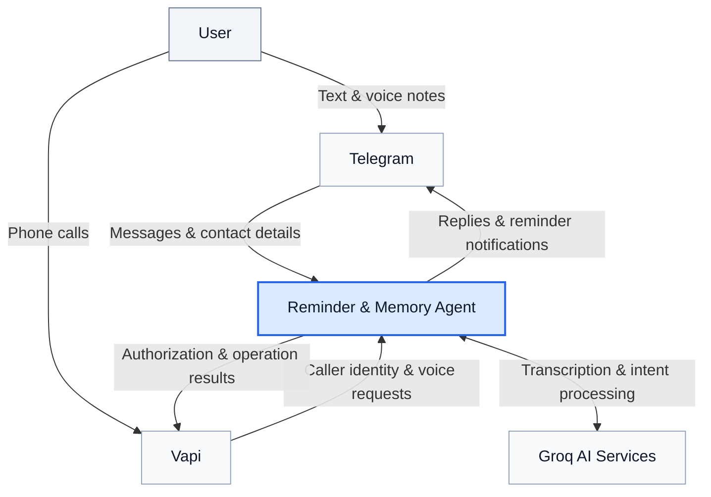

### Container Diagram

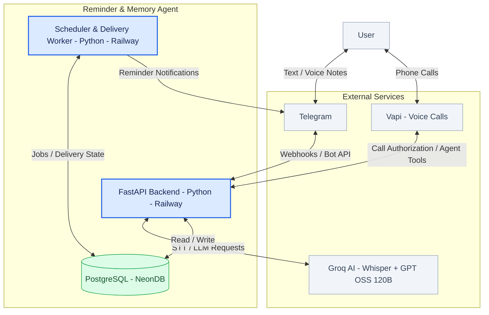

### Voice Call to Telegram Reminder Flow

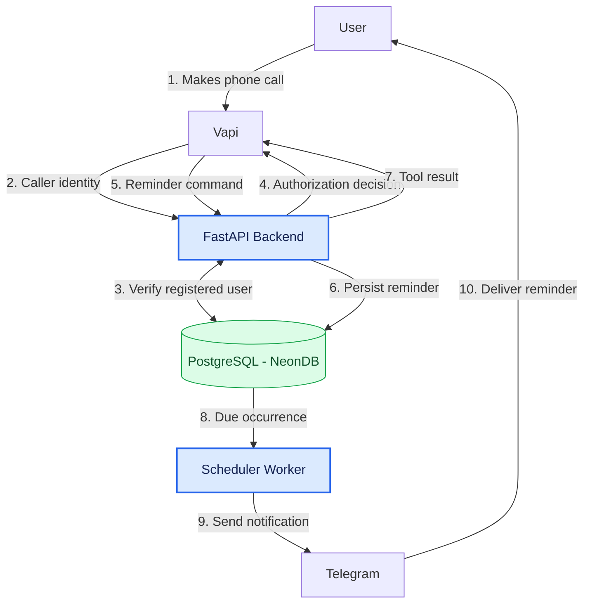

## 6. API Architecture and Contracts

### Webhook and Health Endpoints

- `POST /webhook/telegram` (receive onboarding, contact sharing, text commands, and voice notes)
- `POST /webhook/vapi` (handle incoming call authorization, tool calls, and call events)
- `GET /health` (report whether the http application is running)
- `GET /ready` (report the readiness of required dependencies)

### Core Application API

- `GET /api/v1/me` (retrieve authenticated user)
- `PATCH /api/v1/me` (update name or time zone)
- `POST /api/v1/reminders` (create one time or recurring reminders)
- `GET /api/v1/reminders` (retrieve reminders which may be filtered by status or period)
- `GET /api/v1/reminders/{id}` (retrieve one reminder)
- `PATCH /api/v1/reminders/{id}` (update task or schedule)
- `POST /api/v1/reminders/{id}/cancel` (cancel a reminder or series)
- `POST /api/v1/occurrences/{id}/complete` (complete a reminder occurrence)
- `POST /api/v1/occurrences/{id}/snooze` (snooze a reminder occurrence)
- `POST /api/v1/memories` (store a memory fact)
- `GET /api/v1/memories` (retrieve/search memory facts)
- `PATCH /api/v1/memories/{id}` (update an existing fact)

**Idempotency:** The original design calls for idempotency keys on most state-changing operations; health and readiness checks are excluded.

### Request Processing Architecture

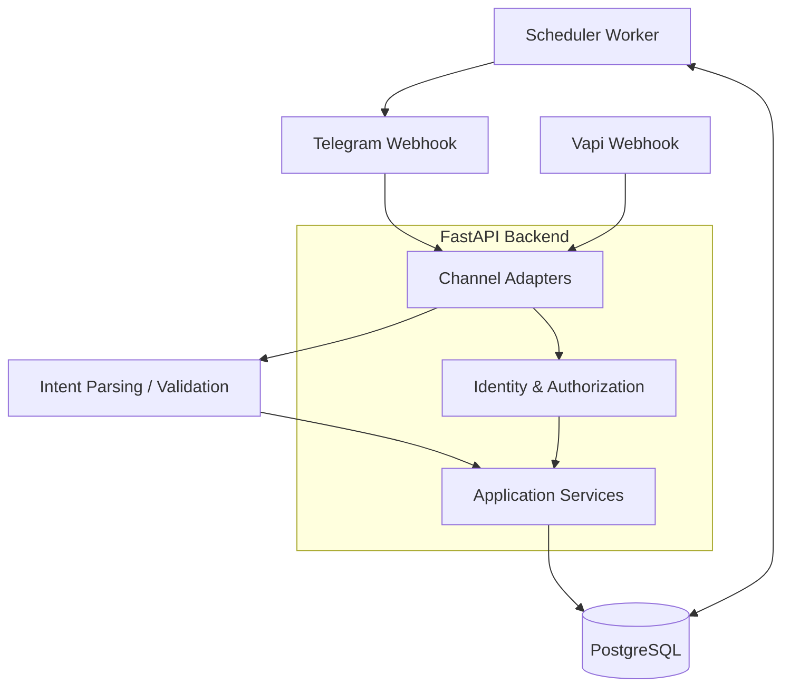

### HTTP Response Codes

| HTTP status | Meaning |
| --- | --- |
| `200 OK`|Successful read or state update|
| `201 Created`|Reminder or memory successfully created|
| `202 Accepted`|Request durably accepted for asynchronous processing|
| `400 Bad Request`|Malformed or invalid input|
| `401 Unauthorized`|Missing or invalid authentication|
| `403 Forbidden`|Authenticated caller lacks permission|
| `404 Not Found`|Resource does not exist or is not accessible|
| `409 Conflict`|State conflict or duplicate phone association|
| `422 Unprocessable Content`|Structurally valid request fails semantic validation|
| `503 Service Unavailable`|A required dependency is unavailable|

## 7. Database Schema

The following tables and constraints reflect the original draft schema. Names, types, and constraints are retained as design notes rather than silently changed into implementation decisions.

### Users

`id` UUID PK, `name` varchar(150), `timezone` varchar(150), `onboarding_status` varchar(150) NOT NULL default=PENDING, `created_at` TIMESTAMPTZ NOT NULL, `updated_at` TIMESTAMPTZ NOT NULL

**Check constraints:** `onboarding_status IN ('PENDING', 'ACTIVE')`

### Channel Identities

`id` UUID PK, `user_id` FK, `channel_type` VARCHAR(20) NOT NULL, `external_id` VARCHAR(255) NOT NULL, `status` VARCHAR(20) NOT NULL, `verified_at` TIMESTAMPTZ, `telegram_chat_id` BIGINT, `created_at` TIMESTAMPTZ NOT NULL

**Check constraints:**
- `channel_type IN ('TELEGRAM', 'PHONE')`
- `status IN ('PENDING', 'LINKED', 'UNLINKED')`

### Reminders

`id` UUID PK, `user_id` FK, `task` TEXT NOT NULL, `schedule_type` VARCHAR(20) NOT NULL, `start_local` VARCHAR(64) NOT NULL, `timezone`, `recurrence_rule` TEXT, `status` VARCHAR(20) NOT NULL default=NULL, `version` INTEGER NOT NULL default=1, `created_at` TIMESTAMPTZ, `updated_at` TIMESTAMPTZ

**Check constraints:**
- `schedule_type IN ('ONE_TIME', 'RECURRING')`
- `status IN ('ACTIVE', 'COMPLETED', 'CANCELED')`
- `version >= 1`
- `recurrence_rule IS NOT NULL` iff `schedule_type = 'RECURRING'`

### Reminder Occurrences

`id` UUID PK, `reminder_id` FK, `scheduled_at` UTC TIMESTAMPTZ, `next_due_at` UTC TIMESTAMPTZ, `status` VARCHAR(20) NOT NULL default=PENDING, `created_at` TIMESTAMPTZ, `updated_at` TIMESTAMPTZ

**Check constraints:** `status IN ('PENDING', 'NOTIFIED', 'COMPLETED', 'CANCELED')`

**Unique constraint:** `(reminder_id, scheduled_at)`

### Notifications

`id` UUID PK, `occurrence_id` FK, `destination_identity_id` FK, `sequence`, `due_at` UTC, `status` VARCHAR(20) NOT NULL default=PENDING, `sent_at` TIMESTAMPTZ, `provider_message_id` VARCHAR(255), `created_at` TIMESTAMPTZ, `attempt_count` INTEGER NOT NULL default=0

**Check constraints:**
- `status IN ('PENDING', 'SENDING', 'SENT', 'FAILED', 'UNKNOWN', 'CANCELED')`
- `attempt_count >= 0`
- `sequence >= 1`

### Memory Facts

`id` UUID PK, `user_id` FK, `content` TEXT NOT NULL, NOT EMPTY, `created_at` TIMESTAMPTZ, `updated_at` TIMESTAMPTZ

### Conversation Sessions

`id` UUID PK, `user_id` FK, `channel_type` VARCHAR(20) NOT NULL, `external_session_id` VARCHAR(255) NOT NULL, `active_reminder_id` FK->reminders.id, `pending_clarification` JSONB, `status` VARCHAR(30) default=active, `updated_at` TIMESTAMPTZ

**Check constraints:**
- `channel_type IN ('TELEGRAM', 'VOICE_CALL')`
- `status IN ('ACTIVE', 'AWAITING_CLARIFICATION', 'ENDED')`

### Idempotency Records

`id` UUID PK, `source`  VARCHAR(20) NOT NULL, `idempotency_key`  VARCHAR(255) NOT NULL, `user_id` FK->users.id, `operation`  VARCHAR(20) NOT NULL, `request_hash`  CHAR(20) NOT NULL, `status`  VARCHAR(20) NOT NULL default=PROCESSING, `response` JSONB, `created_at` TIMESTAMPTZ, `updated_at` TIMESTAMPTZ, `expires_at` TIMESTAMPTZ

**Check constraints:**
- `source IN ('TELEGRAM', 'VAPI')`
- `status IN ('PROCESSING', 'SUCCEEDED', 'FAILED')`

**Unique constraint:** `(source, idempotency_key)`

### Idempotency Design Decision

Three approaches were evaluated:

| Approach | Advantages | Tradeoffs |
| --- | --- | --- |
| Store keys in existing domain tables | Low initial implementation complexity; no new infrastructure; can be made transactional with business operations | Fields would be spread across multiple tables; different operations require different deduplication logic; storing previous results is awkward; less maintainable over time |
| Redis | Supports deduplication | Adds an infrastructure dependency and operational overhead |
| Dedicated PostgreSQL table | Consistent deduplication across operations, durable across restarts, transactionally coupled with business changes, supports saved operation results, one additional table | Adds a dedicated table and a moderate amount of shared application logic |

**Decision:** Use a dedicated PostgreSQL idempotency table. It supports consistent handling for reminder creation, rescheduling, completion, cancellation, and memory operations without adding Redis. It is intended to simplify maintenance and allow prior operation results to be retained.

## 8. Intent Interpretation and Execution

Incoming messages must be interpreted as a supported intent or a request for clarification. Before executing a domain operation, the backend validates the request and checks the caller’s authorization. Idempotency records and conversation sessions support retry handling and unresolved requests.

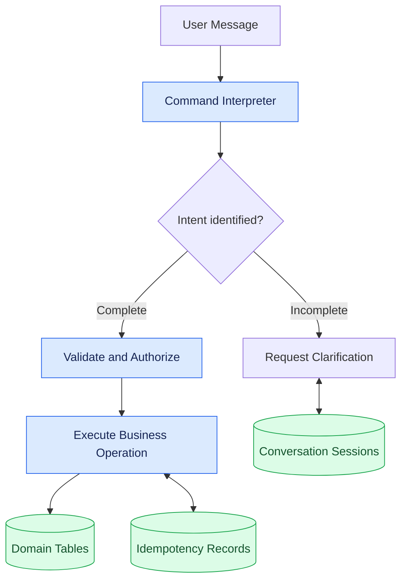

## 9. Implemented Architecture: VS-01 through VS-14

This section records the architecture implemented for VS-01 through VS-14. It is an implementation supplement to the original design material above: it does not change the existing requirements, workflows, or designs for later slices.

### 9.1 Current Component Architecture

The running system consists of a Telegram webhook adapter, shared reminder and memory application services, PostgreSQL persistence, and a separate worker process. The implemented Telegram path supports onboarding and verified phone linking, one-time and recurring reminders, memory saving, clarification, unsupported-request responses, listing, rescheduling, cancellation, and completion of delivered occurrences.

`api.telegram.telegram_webhook` verifies Telegram's webhook secret, validates the incoming `TelegramUpdate`, and calls `onboarding.handle_update`. Once onboarding is active, that function delegates text requests to `reminders.handle_reminder_text`. The handler resolves the trusted Telegram identity, checks idempotency, applies request policy, and then invokes the appropriate service. It does not accept user-supplied identifiers as authority.

**Current system architecture.** This view shows the deployed containers and external dependencies, not the internal request sequence.

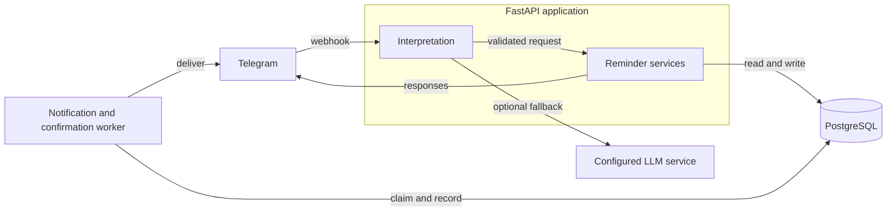

The FastAPI application contains deterministic interpretation with optional LLM fallback and the shared reminder application services. PostgreSQL holds operational, session, and delivery state; the worker handles durable confirmation retries and scheduled delivery.

Implemented service boundaries are deliberately small and operation-specific:

- `onboarding.py` creates Telegram identities, collects time zones, and verifies self-shared phone contacts.
- `reminders.py` is the Telegram orchestration boundary for creation, clarification, listing, rescheduling, and cancellation.
- `completion.py` resolves and completes only an owned, already-delivered occurrence.
- `reminder_listing.py`, `rescheduling.py`, and `cancellation.py` implement owned-reminder lookup, candidate selection, grounding, and transactional change rules.
- `recurrence_service.py` materializes upcoming recurring instances.
- `memories.py` validates and persists owner-scoped memory facts without reminder side effects.
- `worker.py` contains `NotificationWorker` and `ConfirmationWorker`.

### 9.2 Deterministic-First Natural-Language Processing

Natural-language processing is a deterministic-first hybrid, not a generic command interpreter. The LLM, when configured, proposes a narrow typed classification or parameter result; it never authorizes an operation or writes data itself.

**Mandatory project-wide invariant.** This is the required processing architecture for every current and future vertical slice and supported channel, not a Telegram-only implementation detail. A channel adapter must authenticate its input and resolve the canonical user, then use shared conversation and application services. It must not bypass this sequence, duplicate business logic, or allow an LLM to mutate data. Any change to this invariant requires explicit approval from the project owner before implementation.

The primary execution order for a Telegram text request is:

1. The webhook authenticates and validates the update; `handle_update` resolves the Telegram identity.
2. `handle_reminder_text` verifies the active user, linked Telegram identity, idempotency key, onboarding state, and saved IANA time zone.
3. `conversation_router.route_message` makes a deterministic routing decision from the text and any pending creation context.
   It recognizes only high-precision creation forms: `remember to <action>` and
   `save a reminder to <action>` select reminder creation, while `remember
   that/my <fact>` selects memory saving. Mixed cues such as `remember to keep
   <fact> in mind`, and otherwise ambiguous wording, select `MODEL_FALLBACK`
   rather than guessing.
4. Only a `MODEL_FALLBACK` route calls `OpenAICompatibleIntentRouter.classify`, when a router is configured. The classifier may select `SAVE_MEMORY` for a clearly intentional indirect save request, but not for an ordinary statement. For memory fallback, it also returns typed `MemoryIntentEvidence`: a clear `EXPLICIT_SAVE_REQUEST` plus an exact source span. `reminders.py` accepts that evidence only when its kind, confidence, and source grounding validate; English phrase matching is not used as authorization.
5. The selected route reaches the applicable deterministic parser: `RuleBasedIntentInterpreter`, listing parsing, `parse_reschedule_request`, or `parse_cancellation_request`.
   A `COMPLETE_REQUEST` route bypasses extraction and resolves the delivered occurrence from trusted Telegram context.
6. If that parser permits fallback, `ReminderIntentInterpreter` can ask its configured extraction adapter for a structured proposal. `SAVE_MEMORY` extraction returns typed `SaveMemoryFact` content, which is deterministically schema-validated and grounded in the source text before the shared memory service is called. The classifier evidence and extracted content are both required; extraction content never supplies intent authority. Rescheduling and cancellation first parse and find owned candidates deterministically; their contextual model proposals remain non-authoritative.
7. Parsers, grounding functions, typed Pydantic schemas, and application services validate the result before a transaction changes data. Insufficient information becomes a clarification; unsupported or unsafe input becomes a non-mutating response.

There is no single centralized verifier. Verification is distributed across the parsers and typed schemas in `intent.py`, `restrict_to_explicit_field_updates`, candidate and grounding functions in `rescheduling.py` and `cancellation.py`, identity/ownership checks in `reminders.py`, and eligibility checks in `worker.py`.

**Mandatory processing pipeline.** This is the primary request-processing view for Telegram text, Telegram voice-note transcripts, Vapi utterances, and future supported channels. The LLM paths are fallback branches; a deterministic result does not call either LLM. `Clarify` persists or updates the typed pending context and returns the focused validated question in the response format appropriate to the channel. `Scope` returns the predefined scope-limitation response without mutation.

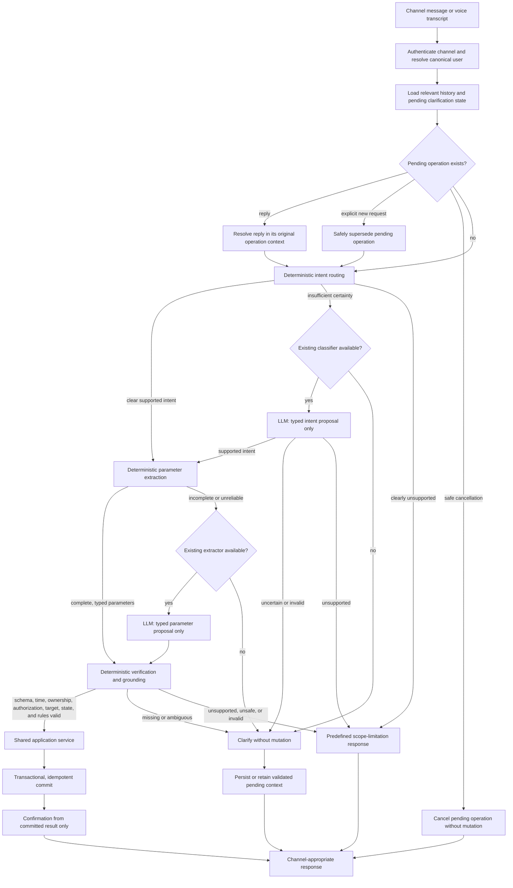

`conversation_router.py` performs the first routing decision. `intent.py` provides the deterministic parser and optional OpenAI-compatible classifiers/extractors. Grounding and authorization remain distributed across `reminders.py`, `rescheduling.py`, `cancellation.py`, and the worker checks; no single verifier is implied.

### 9.3 LLM Configuration and Failure Boundaries

The integration uses OpenAI-compatible chat-completion endpoints. `Settings.llm_base_url`, `Settings.llm_api_key`, `Settings.llm_intent_model`, and `Settings.llm_extract_model` keep the architecture provider-flexible. A configured API key creates both adapters in `main.create_app`; without it, the system continues with deterministic behavior and clarification responses.

The current default models are:

| Responsibility | Setting | Default |
| --- | --- | --- |
| Intent classification | `llm_intent_model` | `openai/gpt-oss-20b` |
| Parameter extraction | `llm_extract_model` | `gpt-5.4-mini-2026-03-17` |

These defaults are configuration values, not a permanent provider or model commitment. Classification selects an operation route only. Extraction proposes parameters for that selected route only. Provider failures, malformed JSON, unsupported proposed operations, invalid typed values, ungrounded fields, missing details, ambiguous targets, and unsafe state changes produce a clarification or a scoped response; they do not execute a mutation.

### 9.4 Persistent Clarification Sessions

`ConversationSession` persists multi-turn state in PostgreSQL. Telegram identifies a session with `telegram_session_id(chat_id)` and stores it under the `(user_id, channel_type, external_session_id)` uniqueness constraint. `conversations.load_session` applies the configured TTL (`conversation_session_ttl_seconds`, default 900 seconds). Expired sessions are ended by the locked path through `end_session`, which clears the payload and active reminder reference.

`pending_clarification` is JSON storage for typed, validated Pydantic contexts:

- `PendingReminder` for one-time reminder creation;
- `PendingReschedule` for a reminder move, including trusted candidate reminder IDs; and
- `PendingCancellation` for reminder cancellation, including candidate reminder IDs and scope/date context.

`pending_from_session`, `pending_reschedule_from_session`, and `pending_cancellation_from_session` validate the stored operation discriminator before using it. `active_reminder_id` is available for a durable active reminder reference. Candidate IDs never grant authorization: the service reloads candidates for the current user and active state.

Session rows are locked when ending or updating a clarification. Creation clarification uses an upsert that increments `version`; rescheduling also compares the observed version before overwriting state. A conflicting or stale update is rejected rather than silently replacing newer context. An explicit new reminder or rescheduling command can supersede an older pending flow, while a list request does not consume an unfinished rescheduling clarification.

**Multi-turn clarification.** This view shows how a follow-up is connected to durable pending context rather than treated as an unrelated command.

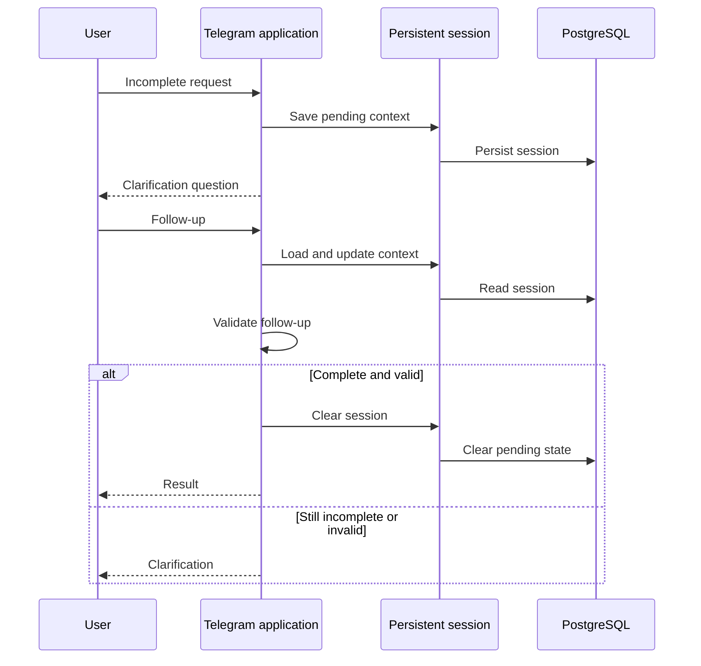

`conversations.py` owns expiry and versioned session access; `reminders.py` uses the typed pending context during validation and execution.

### 9.5 Implemented Persistence and Recurrence Model

The current SQLAlchemy schema and Alembic migrations provide these implemented tables:

- `users`: onboarding status, display name, optional IANA time zone, and optional phone region.
- `channel_identities`: a user-owned `TELEGRAM` or `PHONE` external identity, its link status, verification time, and Telegram chat ID where applicable. Partial unique indexes prevent a linked external identity—and a linked phone identity per user—from being active more than once.
- `reminders`: the user-owned task, one-time or recurring schedule, local start, time zone, recurrence rule, state, and version. Check constraints require a recurrence rule exactly for recurring schedules.
- `reminder_occurrences`: individual due instances with `scheduled_at`, `next_due_at`, state, and, for recurring rows, a stable `recurrence_instance_key`. Both `(reminder_id, scheduled_at)` and `(reminder_id, recurrence_instance_key)` are unique.
- `reminder_recurrence_exceptions`: one durable local-calendar date per recurring reminder, unique by `(reminder_id, occurrence_date)`, used to skip an unmaterialized future instance.
- `notifications`: a due Telegram delivery linked to an occurrence and destination identity, with sequence, status, attempts, provider result, and lease fields.
- `conversation_sessions`: typed pending clarification payloads, channel/session identity, status, optional active reminder reference, version, and update time.
- `idempotency_records`: a unique `(source, idempotency_key)` record with request hash, durable response, business outcome, and confirmation-delivery state.
- `memory_facts`: authoritative non-empty user-owned fact content, nullable
  `vector(1536)` semantic data, model/content-hash/versioning metadata, indexing
  status and attempts, timestamps, and owner/date plus owner/index-status indexes.

The implemented relationships are user-to-identities/reminders/sessions, reminder-to-occurrences/recurrence-exceptions, occurrence-to-notifications, and notification-to-a destination identity. Foreign keys cascade from user to owned rows and from reminder to occurrences/exceptions; notification destinations use `RESTRICT` to preserve delivery ownership. Application transactions persist a state change and its idempotency response together. Outbound Telegram calls occur only after the transaction commits. Rescheduling and cancellation lock the target reminder, relevant occurrences, and pending notifications; they fail safely if a notification is already `SENDING`.

Recurring materialization uses the local wall-clock instant as `recurrence_instance_key`. `materialize_recurring_reminder` skips dates recorded in `ReminderRecurrenceException` and inserts occurrences with conflict-ignore semantics, so repeated or concurrent materialization converges on one logical instance. The exception mechanism implements cancellation/skipping of a specified future occurrence without cancelling the whole series.

For cancellation, an unqualified recurring target defaults to `SERIES`; a one-time target defaults to its occurrence. Series cancellation cancels the reminder and its pending occurrences/notifications. Occurrence cancellation leaves a recurring parent active; if the requested future occurrence has not been materialized, `apply_cancellation` records a recurrence exception instead. For rescheduling, a recurring target without an explicit scope always asks whether to change the upcoming occurrence or all future series instances. An occurrence move replaces its pending notification; a series move updates the recurring schedule and its pending materialized work under locks.

### 9.6 Delivery Architecture

#### Confirmation delivery

Every durable Telegram result is stored in an `IdempotencyRecord` with its response before the request is returned. The webhook then claims the stored response with `onboarding.claim_delivery` and attempts immediate Telegram delivery. `api.telegram._send_reply_with_retry` retries only a 429 response synchronously; other delivery failure results are recorded by `record_delivery_outcome` after the transaction.

`ConfirmationWorker` later leases `UNKNOWN` confirmations that have become due, retries eligible records, and finalizes `SENT`, `FAILED`, or `UNKNOWN` based on the delivery outcome. Expired confirmation leases are recovered as `UNKNOWN`. This preserves a quick synchronous response path while keeping a durable retry path for failed confirmations.

**Reminder creation and confirmation.** The transaction commits the reminder and durable response before Telegram delivery is attempted.

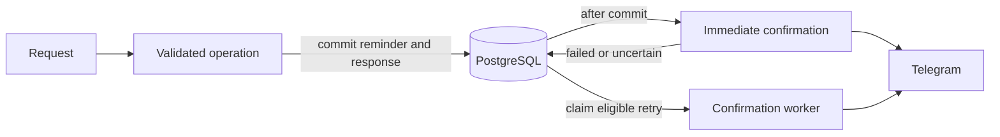

`reminders.py` and `onboarding.py` persist the operation response with its idempotency record. `api/telegram.py` sends the immediate reply, while `ConfirmationWorker` in `worker.py` retries durable failed confirmations.

#### Scheduled reminder delivery and recurrence materialization

`NotificationWorker.run_once` first materializes active recurring reminders inside a short transaction, then recovers expired notification leases, claims due notifications, and delivers them. `claim_due_notifications` joins notification, occurrence, reminder, and destination identity; it only claims a `PENDING` notification whose due time has arrived and whose reminder, occurrence, and linked Telegram destination remain eligible and belong to the same user. The selection uses `FOR UPDATE SKIP LOCKED`, then marks each row `SENDING` with `claimed_by`, `claimed_until`, attempt count, and attempt time in the committed claim transaction.

Telegram is called after claiming commits. A successful call marks the notification `SENT` and its occurrence `NOTIFIED`. Retryable connection failures and rate limits return a row to `PENDING` at a backoff-adjusted due time while attempts remain. Uncertain network or provider outcomes are limited and can become `UNKNOWN`; non-retryable outcomes become `FAILED`. On restart or lease expiry, in-flight `SENDING` work is recovered as `UNKNOWN` instead of being assumed unsent.

This is durable, leased, at-least-once-oriented processing, not a strict exactly-once external Telegram guarantee. A provider may accept a message while the response is lost or a worker may stop after the external send and before finalization; retrying uncertain work can therefore produce a duplicate or remain `UNKNOWN`.

**Scheduled reminder delivery.** The worker materializes recurring work when needed, then delivers only eligible claimed notifications.

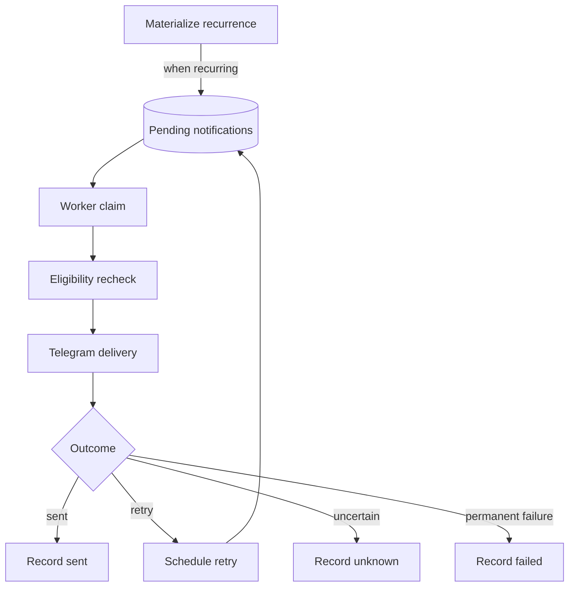

`recurrence_service.py` creates future work. `NotificationWorker` in `worker.py` claims due notifications with leases, rechecks eligibility, and records `SENT`, retryable, `FAILED`, or `UNKNOWN` outcomes. `UNKNOWN` preserves provider uncertainty rather than claiming exactly-once delivery.

### 9.7 Delivered-occurrence completion (VS-11)

VS-11 adds completion without changing the persistence schema. The existing
`provider_message_id`, occurrence state, reminder state, Telegram identity, and
idempotency records are sufficient to ground the operation.

Telegram reminder notifications include a signed inline `Done` callback. The
webhook validates the callback signature, private chat, sender identity, linked
Telegram destination, occurrence ownership, and the callback message's stored
provider message ID before changing state. A textual `Done` reply uses the
replied-to Telegram `message_id` as the preferred lookup. A bare completion
phrase is accepted only when exactly one eligible delivered occurrence exists;
zero or multiple candidates result in clarification and no mutation.

The completion service locks the occurrence and delivered notification, then
rechecks ownership and delivery before setting the occurrence to `COMPLETED`.
For a one-time reminder it also completes the parent reminder; for a recurring
reminder the parent series remains `ACTIVE`. The service does not commit by
itself: the state transition and the Telegram update's `IdempotencyRecord` are
committed together. Replayed updates return the stored response and do not
repeat the state change. Callback-query acknowledgement is best-effort UI
feedback and is independent of the durable completion transaction.

Completion is deterministic. The intent classifier knows the
`COMPLETE_REQUEST` route, but the application does not use an LLM-generated
occurrence ID or target as authority. The extractor prompt documents the
completion operation for route consistency, while the actual completion path
bypasses extraction and resolves only from trusted Telegram delivery context.

### 9.8 Delivered-occurrence snooze (VS-12)

VS-12 reuses the delivered-occurrence resolution and authorization boundary
introduced by VS-11. A Telegram reply is first grounded to the stored
`provider_message_id`; a bare snooze is accepted only when exactly one distinct
owned, linked, delivered occurrence is eligible. Historical sent notifications
are collapsed for candidate selection, but remain immutable delivery history.

The deterministic router recognizes explicit positive relative durations before
any model call. If routing is uncertain, the configured classifier may propose
`SNOOZE_REQUEST`; only then may the extractor propose a positive
`duration_seconds`. Neither model may supply an occurrence ID, user ID, chat ID,
or delivery destination. Invalid, ambiguous, stale, or unauthorized proposals
produce clarification and no mutation.

The snooze service locks the occurrence and rechecks the authenticated Telegram
identity, parent reminder, occurrence state, and matching sent notification.
Within the caller's transaction it changes the same occurrence from
`NOTIFIED` to `PENDING`, updates `next_due_at` to `now + duration`, and inserts
one new `PENDING` notification with the next sequence number. It does not create
another occurrence, alter a recurring rule, or modify the previous `SENT`
notification. The idempotency response and state change commit together; a
replayed Telegram update returns the stored response and does not postpone the
occurrence twice.

The normal notification worker delivers the replacement notification through
its existing eligibility and lease path. Once sent, the occurrence becomes
`NOTIFIED` again and the replacement receives its own provider message ID. A
pending snooze clarification retains its typed candidate context, can be safely
canceled, is superseded by an explicit new mutation, and is not consumed by a
read-only list or summary request.

### 9.9 Saved memory facts (VS-13)

VS-13 adds a minimal `memory_facts` table and a shared `memories.py` service. A
high-precision explicit fact command such as “Remember my …” or “Remember
that my …” is recognized deterministically. Explicit reminder wording such as
“Remember to call …” and “Save a reminder to …” is routed to reminder
creation instead. Mixed creation cues and other natural-language variants use
the existing classifier,
which returns structured save-intent evidence rather than relying on a growing
English phrase allowlist. Evidence must be a clear explicit-save classification
with a grounded source span; ordinary statements, quoted instructions, negated
requests, reminder requests, and uncertain classifications do not reach memory
extraction. The fact body is
validated for non-empty content and saved under the canonical Telegram user's
ID; message text, model output, and user-supplied identifiers never select the
owner. Saving a fact does not create a reminder, occurrence, or notification.

An incomplete command such as “Remember” persists a typed `SAVE_MEMORY`
clarification in the existing `conversation_sessions` table. A valid follow-up
executes that original operation once; cancellation, expiry, and explicit new
commands are handled without mutation of the old draft. The save and its
`IdempotencyRecord` commit together, and the Telegram confirmation is sent only
after commit. Replayed Telegram updates return the stored response without
inserting another fact. Memory request text is omitted from the classifier's
durable recent-message history so secrets are not unnecessarily duplicated in
idempotency payloads; logs contain only metadata such as content length.

### 9.10 Retrieved memory facts (VS-14)

VS-14 keeps memory reads on the same authenticated Telegram and shared-memory
service boundary as saving. High-precision forms such as "What's my gate code?"
extract their subject deterministically and query only facts owned by the
canonical user. Reminder/date wording takes precedence over a question-shaped
memory lookup: "What's my reminder for tomorrow?" and "What reminders do I
have tomorrow?" are read-only reminder-list requests.

If the deterministic router cannot reliably identify the requested subject, it
may use the existing classifier to select `RETRIEVE_MEMORY`, then the existing
typed extractor to propose only `RetrieveMemoryQuery.query`. The proposal is
schema-checked, rejects answer/value and fact/user-ID fields, and must be
grounded in the original request before an owner-scoped database search. The
LLM cannot return a fact value, choose a fact ID, select a user, or authorize
access; response text is formed only from a fact returned by the shared lookup
service.

Candidate matching treats every owner-scoped fact that contains the requested
subject as plausible. It does not rank one lexical phrase match above another
potentially conflicting fact; multiple matches produce a typed
`RETRIEVE_MEMORY` clarification context with trusted candidate IDs, while an
unknown subject returns an explicit unknown response. A narrowing reply reloads
only the current owner's candidate rows. An expired lookup context is ended and
returns a memory-specific expiration response rather than applying its stale
candidate IDs.

Direct, successful or unknown memory reads intentionally do not create an
`IdempotencyRecord` because they do not change domain state. Consequently a
replayed direct Telegram read can send the response again. This is an accepted
VS-14 response-delivery limitation, not an idempotency or authorization gap;
response-level deduplication remains future work if Telegram duplicate replies
become operationally unacceptable.

### 9.11 PostgreSQL semantic memory indexing

Migration `0016_memory_embeddings` enables the PostgreSQL `vector` extension
and adds a nullable `vector(1536)` column to the existing `memory_facts` table.
It is additive: existing fact text and identifiers are unchanged and existing
rows receive `embedding_status=PENDING`. `content` remains the authoritative
fact and is the only value returned to a user. The current schema is compatible
with either the configurable OpenAI-compatible adapter or Google's
`gemini-embedding-001` adapter at 1,536 dimensions and cosine distance. Gemini
uses `RETRIEVAL_DOCUMENT` for saved facts and `RETRIEVAL_QUERY` for questions;
its 1,536-dimensional Matryoshka prefix is manually L2-normalized after
truncation as required by Google's guidance. The provider boundary is a small
`EmbeddingProvider` protocol; deterministic fakes are used in automated tests.

Embedding work starts only inside the already authorized memory-save service,
after intent, extraction, grounding, canonical-user resolution, pending-context
validation, and replay checks. A successful vector is recorded as `INDEXED`
with its model name and SHA-256 content hash. Provider failure does not roll
back the fact: the original content commits as `FAILED`, with only a sanitized
error category and attempt count, and can be retried. A disabled provider
stores `PENDING`. The save confirmation says only that the information was
saved and never claims semantic indexing succeeded. Replayed Telegram save
events return their committed idempotent result without repeating embedding
work.

`memory-embedding-backfill` locks at most 100 eligible rows with `FOR UPDATE
SKIP LOCKED`, regenerates vectors from current authoritative content, and
commits one resumable batch. Content updates invalidate or regenerate their
vector; matching model and content hashes make regeneration a no-op. Model
changes are handled by deploying a compatible schema migration when dimensions
change, updating the provider/model configuration, and repeatedly running the
backfill. During that transition, retrieval only uses rows indexed by the active
model/configuration; embeddings from incompatible models are never compared. A
dimension change always requires a new Alembic migration; it must never
reinterpret an existing vector column in place.

Retrieval remains deterministic-first. It runs an owner-filtered, bounded lexical
query and returns a single exact subject match without calling either an LLM or
the embedding provider. Multiple lexical matches enter the existing typed
`RETRIEVE_MEMORY` clarification flow. Only when lexical evidence is insufficient
does the service embed the query and issue an exact, bounded PostgreSQL cosine
search constrained by both canonical `user_id` and active embedding model.
Scores below the configurable relevance threshold are unknown; candidates close
within the configurable ambiguity margin clarify instead of letting the highest
score hide a plausible conflict. Thresholds are configuration values exercised
at their boundaries by deterministic tests. HNSW is intentionally absent: exact
owner-filtered search preserves recall and is adequate at current scale. Add an
approximate index only after query plans and per-owner cardinality demonstrate a
need.

Embedding privacy is deny-by-default for external providers. Passwords,
passphrases, PINs, access/gate/door/security codes, API keys, tokens, private
keys, recovery/seed phrases, and similar detected secrets are marked
`SKIPPED_SENSITIVE` and remain lexically retrievable; their content is not sent
externally unless `EMBEDDING_ALLOW_SENSITIVE_EXTERNAL=true` reflects an approved
deployment policy. The same rule suppresses sensitive query embedding. Raw
memories, query contents, vectors, provider responses, and credentials are not
logged. If the provider or semantic index is unavailable, retrieval falls back
to deterministic lexical behavior and otherwise responds unknown or asks for
clarification; it never invents a value.
